  
    
  

 

hey, i'm 0xAvia. i build discord and telegram bots, websites, panels and whatever small tool i need that week. most of it runs on my own servers, not here, so the commit graph lies.

**pinned**

- [prompt engineering tutorial](https://github.com/0xAvia/Prompt-Engineering-Tutorial): interactive, beginner friendly course for prompting claude. no coding needed

**elsewhere**

- [xdlol.xyz](https://xdlol.xyz)

 

  <code>&nbsp;.:-=+*#%@&nbsp;</code>
   
  every frame up there is text. no gifs, no js, just svg.

